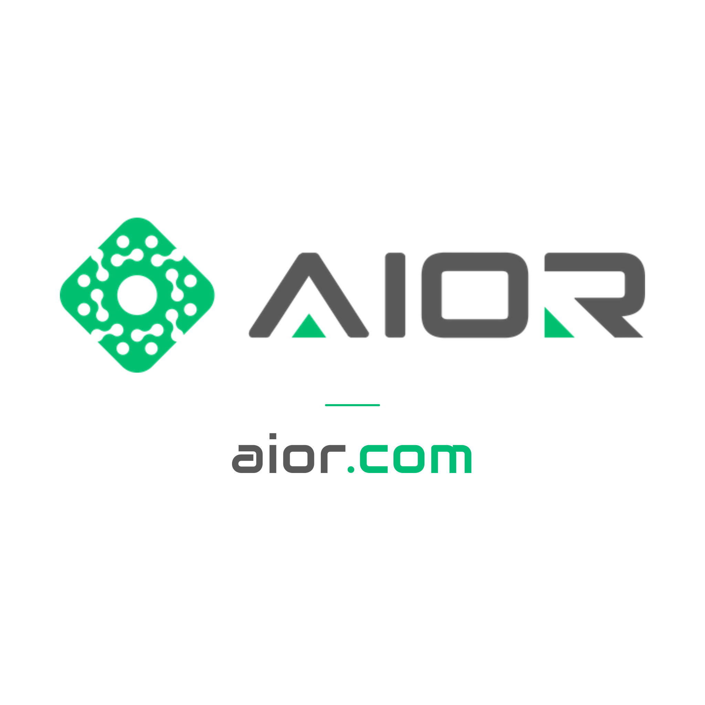

# AIOR

**Software · Design · Automation · Engineering · Hosting**  
**Machine Vision · Quality Control · Traceability**

[Website](https://aior.com/) · [Discuss your project](https://aior.com/contact) · [WhatsApp](https://wa.me/908503098080) · [Email](mailto:hi@aior.com)

## Engineering solutions for real business needs

AIOR develops software and engineering solutions for customers in Türkiye and internationally. We connect business applications, industrial automation, camera inspection and infrastructure to help teams monitor operations, improve quality and trace their processes.

We work in **English and Turkish**. Contact our company by phone or WhatsApp **24/7** to discuss your requirements.

| Solutions | What we help with |
| --- | --- |
| Software | Custom applications, integrations, dashboards and operational tools |
| Design & engineering | System design, technical development and project engineering |
| Industrial automation | PLC integration, process monitoring and control systems |
| Machine vision & camera control | Camera integration, visual inspection and inspection workflows |
| Quality control & traceability | Production records, inspection results and process traceability |
| Hosting & infrastructure | Hosting, cloud, servers, domains and technical troubleshooting |

[Explore our services](https://aior.com/services) · [Projects](https://aior.com/projects) · [Technology ecosystem](https://aior.com/partners) · [AIOR Forum](https://aiorforum.com/)

## Türkçe

**AIOR**, Türkiye'deki ve uluslararası müşterileri için **yazılım, tasarım, otomasyon, kamera kontrolü, mühendislik ve hosting çözümleri** geliştirir. Kalite kontrolü ve izlenebilirlik uygulamalarını iş süreçleri, üretim sistemleri ve altyapıyla birlikte ele alır.

Özel yazılım ve entegrasyonlar, PLC ve proses otomasyonu, görüntü işleme, kamera tabanlı kontrol, üretim takibi, sunucu ve hosting ihtiyaçlarınız için bizimle iletişime geçebilirsiniz. **Türkçe ve İngilizce iletişim; şirket telefonuna ve WhatsApp hattına 7/24 ulaşım.**

## Contact / İletişim

- **Website:** [aior.com](https://aior.com/)
- **Email:** [hi@aior.com](mailto:hi@aior.com)
- **Phone:** [+90 532 349 00 20](tel:+905323490020)
- **WhatsApp:** [+90 850 309 80 80](https://wa.me/908503098080)
- **Community:** [aiorforum.com](https://aiorforum.com/)
- **Company:** AIOR TEKNOLOJI LIMITED SIRKETI · Türkiye

[LinkedIn](https://www.linkedin.com/company/aiorcom/) · [Instagram](https://www.instagram.com/aiorcom/) · [Facebook](https://www.facebook.com/aiorcom/) · [Threads](https://www.threads.com/@aiorcom) · [YouTube](https://www.youtube.com/@aiorcom) · [X](https://x.com/aiorcom)

Brand assets: [white background — primary](assets/aior-profile-light.png) · [dark background — alternative](assets/aior-profile-dark.png)
